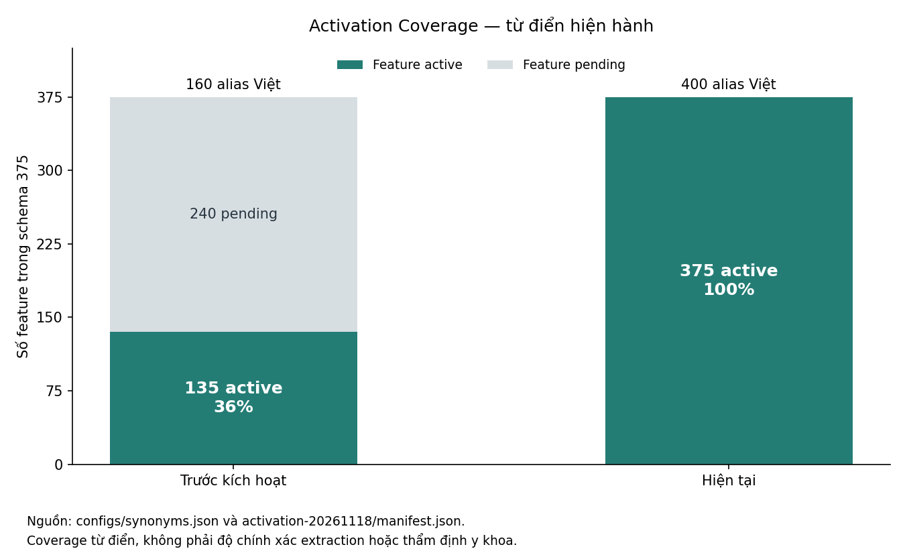

# Disease Prediction Using Machine Learning

## 1. Giới thiệu đồ án

**Lắng nghe** là đồ án phân loại bệnh bằng Machine Learning và chatbot triệu chứng tiếng Việt. Hệ thống nghiên cứu luồng từ lời kể → trích xuất triệu chứng → đặc trưng nhị phân → mô hình đã huấn luyện → gợi ý có kiểm soát.

**Đây là hệ thống học thuật, không thay thế chẩn đoán hoặc tư vấn y tế.** Kết quả trên dữ liệu nghiên cứu không chứng minh hiệu quả lâm sàng. Khi có dấu hiệu khẩn cấp, chatbot dừng dự đoán và hướng người dùng tìm hỗ trợ y tế.

## 2. Dữ liệu và phạm vi nghiên cứu

- Bộ dữ liệu sau xử lý: **187.434 records, 375 symptom features, 587 disease classes**; có tính tổng hợp và nhiều vector triệu chứng trùng/xung đột nhãn.
- Chia train/validation/test theo nhóm vector, bảo toàn schema và thứ tự nhãn. Primary metric của disease classification là Macro F1 trên đủ 587 lớp, `zero_division=0`.
- Preprocessing đã fit trên train: input 375 cột → VarianceThreshold giữ **318** cột → classifier.
- Final test đã hoàn tất theo protocol khóa trước; không dùng để chọn lại model, tham số hoặc voting policy. Không chạy lại khi cài website.

Chi tiết nguồn, split, provenance và giới hạn: [ML_EXPERIMENTS](docs/ML_EXPERIMENTS.md).

## 3. Kiến trúc hệ thống

```text
Giao diện tiếng Việt
  → FastAPI /api/v1/chat + session
  → Rule-based extraction + evidence/subject/assertion validation
  → Hỏi làm rõ + quality gate + urgent guard
  → Vector 375 feature theo canonical schema
  → Fitted VarianceThreshold 318 → LR tuned C=2
  → Top 3 thật + phản hồi tiếng Việt theo template
```

Extraction nằm ở **backend Python**, không chạy trong trình duyệt. Frontend gửi lời kể và hiển thị kết quả; không tự tạo feature, bệnh hoặc điểm dự đoán. `POST /api/v1/predict` nhận feature hợp lệ có cấu trúc, phục vụ kiểm tra ML riêng với chatbot.

Runtime mặc định **offline**, không cần API key. Các provider LLM là tùy chọn có cấu hình rõ ràng; không tự gửi cùng lời kể sang provider khác. Semantic/Hybrid trong Notebook 07 chỉ là nghiên cứu, chưa bật trong API/website. [Kiến trúc chi tiết](docs/SYSTEM_ARCHITECTURE.md).

## 4. Thí nghiệm và lựa chọn mô hình

| Thí nghiệm | Nội dung | Kết quả validation Macro F1 tiêu biểu |
|---|---|---|
| 1 — Baseline | Logistic Regression, LinearSVC, Random Forest, KNN, BernoulliNB | LR baseline: **0,78780814**, cao nhất trong năm baseline |
| 2 — Baseline ensemble | Ba Hard Voting, hai Soft Voting | Hard LR+SVC+KNN: **0,78733399**, chưa vượt LR baseline |
| 3 — Hyperparameter tuning | Group-aware CV, train-only preprocessing; đánh giá validation riêng | LR tuned C=2: **0,79315438**, cao nhất trong năm single tuned |
| 4 — Tuned ensemble | Dùng tuned checkpoints và voting policy đã khóa | Hard tuned LR+SVC+KNN: **0,79651707**, validation cao nhất đã quan sát |

Nguồn và precision đầy đủ: [bảng kết quả và audit evidence](docs/ML_EXPERIMENTS.md). Bảng trên chỉ dùng **validation**, không trộn final test để chọn mô hình.

Owner chọn **LR tuned C=2 trước final test** vì có Top 3 từ `predict_proba()`, inference đơn giản và chi phí thấp hơn ensemble. Hard tuned giữ vai trò đối chứng validation mạnh nhất; bootstrap CI của chênh lệch chứa 0, không đủ kết luận ưu thế thống kê. Không nói LR tuned thắng validation Macro F1 hoặc ensemble luôn kém hơn.

## 5. Các chức năng chính

- Nhận lời kể tiếng Việt, phủ định, uncertainty và ngữ cảnh chủ thể; hỏi làm rõ khi thiếu dữ kiện/nhập nhằng.
- Hội thoại nhiều lượt, batch questions, preview theo yêu cầu và bắt đầu phiên mới; chỉ dự đoán sau quality gate.
- Top 3 thật của LR tuned, giữ nguyên thứ hạng/điểm, không chuẩn hóa ba điểm thành 100%.
- API kiểm tra input/schema, checkpoint checksum và môi trường; thiếu artifact thì dừng, không fallback baseline.

Điểm hiển thị là **điểm mô hình chưa calibration**, không phải xác suất mắc bệnh hay Accuracy của riêng một câu. Accuracy toàn tập test, khi hiển thị, là metric đánh giá riêng. Từ điển đã kích hoạt **375/375 feature với 400 alias Việt**, theo phê duyệt của owner. Đây là coverage của từ điển, không phải độ chính xác hiểu mọi câu; thuật ngữ chưa được thẩm định y khoa. Alias nhập nhằng vẫn hỏi làm rõ, không ép khớp. [Danh sách 375 feature và trạng thái hiện hành](reports/terminology/activation-20261118/feature_coverage.csv).



Hình coverage đọc từ dictionary release hiện hành; các hình và metrics NLP lịch sử giữ nguyên phiên bản dictionary khi thực nghiệm.

Trên Windows CPython 3.13.17/AMD64 với đúng dependency pins, LR tuned, LR baseline và Hard tuned LR+SVC+KNN đã runtime-qualified khi đủ artifacts; LR tuned vẫn là mặc định. Hai LR trả Top3 từ predict_proba; Hard tuned trả nhãn thắng, phiếu và từng thành viên, không có probability Top3. Restart server sau cập nhật source và bắt đầu phiên mới khi đổi model. Xem trạng thái thực tại `GET /api/v1/models`.

## 6. Công nghệ sử dụng

Python, pandas/NumPy/SciPy, scikit-learn/joblib, FastAPI/Pydantic/Uvicorn, HTML/CSS/JavaScript, pytest và Jupyter/Colab. Notebook 07 chuẩn bị sentence embeddings multilingual như dependency nghiên cứu tùy chọn, không phải dependency website.

```text
app/              # Backend FastAPI và frontend local
src/              # Data, model loaders và agent/extraction
configs/          # Cấu hình công khai, identities và dictionary
notebooks/        # Audit, 4 thí nghiệm, inference, closeout, NLP research
scripts/          # Audit, smoke, staging và công cụ nghiên cứu
tests/            # Regression/synthetic fixtures
data/evaluation/  # Các câu NLP synthetic nhỏ, không phải disease dataset
reports/          # Evidence/bảng/hình nghiên cứu nhỏ được quản lý trong Git
docs/             # Kiến trúc, thực nghiệm, triển khai và bàn giao
```

Project dùng một cây thống nhất: `data/`, `artifacts/`, `reports/` nằm cạnh source. Repository phân phối dataset/checkpoint đã khóa cùng metadata, predictions và reports. CSV raw và mười fitted pipelines dùng **Git LFS**; metadata và các file nhỏ dùng Git thường. Cache embedding công khai của Notebook07 vẫn có thể tái tạo theo revision/checksum, không đưa lên repository.

## 7. Cài đặt và chạy thử

```powershell
git clone https://github.com/Leafguy2341/disease-prediction-ml.git
cd disease-prediction-ml
git lfs install --local
git lfs pull
```

Cài Git LFS trước khi clone. Nếu đã clone source cũ, pull nhánh đã merge rồi chạy `git lfs pull`; không cần tải gói data riêng cho inventory hiện hành. Kiểm đầy đủ file và SHA trước khi chạy notebook/API:

```powershell
py -3.13 -B -m scripts.verify_repository_data --allow-locked-bytes
```

Lệnh chỉ băm byte để kiểm integrity, bao gồm file test được phân phối; không parse dataset/predictions, fit hoặc đánh giá test. [Repository data manifest](artifacts/metadata/repository_data_manifest.json) liệt kê từng file/size/SHA và kết quả đối chiếu thư mục data cũ. Download ZIP có thể chỉ chứa LFS pointers tùy thiết lập GitHub; ưu tiên clone và LFS pull. [external_data_release.json](configs/external_data_release.json) giữ identity gói ZIP lịch sử, không bị sửa thành inventory Git mới. Source/config cũ trong folder data không được copy đè lên code hiện hành.

Đủ file không thay thế setup Python/dependencies/Drive. Notebook00–06 giữ các cell đã chạy với locator Colab `MyDrive/ML_Projects/disease-prediction-ml`; Drive thực tế của owner đã được quan sát ở `MyDrive/ML_Projects/disease-prediction-ml-data`. Cần setup đúng storage root/source đã publish khi chạy Colab; push GitHub không tự sửa hoặc đồng bộ Drive. Notebook07 có thể tải pinned embedding cache lần đầu. Không Run All notebook03/04/06 chỉ để mở web hoặc xem kết quả.

```text
disease-prediction-ml/
├── app/, src/, configs/, notebooks/, scripts/, tests/, docs/
├── data/        # raw/, processed/, evaluation/
├── artifacts/   # models/, metadata/
├── reports/
└── run_api.py
```

Để load checkpoint trên Windows cần **CPython 3.13.17/AMD64** đã được qualify, scikit-learn 1.6.1, NumPy 2.1.3, SciPy 1.16.3, joblib 1.6.0. Kiểm đúng interpreter trước khi tạo môi trường; không dùng Python 3.11/sklearn 1.8 để bỏ qua production guard.

```powershell
py -3.13 --version
# Chỉ tiếp tục khi đúng 3.13.17; tạo môi trường nếu chưa có.
py -3.13 -m venv .venv-web
& '.\.venv-web\Scripts\python.exe' -m pip install -r requirements-api.txt
$env:DISEASE_API_STORAGE_ROOT = (Get-Location).Path
$env:DISEASE_CHAT_MODE = 'offline'
& '.\.venv-web\Scripts\python.exe' -B -m scripts.smoke_local_mvp --ml
& '.\.venv-web\Scripts\python.exe' -B run_api.py
```

`run_api.py` mặc định dùng thư mục chứa chính nó làm storage root; environment override được giữ nguyên nếu đã đặt. Nếu terminal còn trỏ tới data root cũ, đặt lại như lệnh trên rồi restart server. Chạy Uvicorn trực tiếp vẫn cần environment root rõ ràng. Mở **http://127.0.0.1:8000/**; OpenAPI: **http://127.0.0.1:8000/docs**. Nếu cổng đang dùng, dừng đúng server cũ bằng Ctrl+C hoặc thêm `--port 8001`. Nếu thiếu data root, không tạo thư mục rỗng thay checkpoint: kiểm lại vị trí giải nén và environment trong đúng terminal.

| Endpoint | Chức năng |
|---|---|
| `GET /health` | Readiness của checkpoint/runtime |
| `GET /api/v1/models` | Các model khả dụng và lý do bị khóa |
| `POST /api/v1/predict` | Feature hợp lệ → kết quả fitted model |
| `POST /api/v1/chat` | Hội thoại qua extraction và quality gate |

Ví dụ input ML: `{"model_id":"lr_tuned_c2","present_features":["cough","fever"]}`. Không cần API key trong offline mode. Lỗi `/health` 503 cần xem mã lỗi thực tế; đã cấu hình không đồng nghĩa model đã load. [Setup, smoke và troubleshooting](docs/DEPLOYMENT_GUIDE.md).

## 8. Hướng dẫn notebook

Đọc [chỉ mục notebook](notebooks/README.md), ưu tiên outputs đã lưu, **không Run All để mở website hoặc trình bày kết quả**.

- 00–02: dataset audit, EDA và preprocessing.
- 03: baseline + tuning; 04: baseline/tuned ensemble — bốn thí nghiệm disease classification.
- 05: structured inference của năm baseline; không phải loader API LR tuned.
- 06: completed final-evaluation viewer chỉ đọc, gate False/authorization rỗng; không mở lại test.
- 07: Rule-based/Semantic/Hybrid symptom extraction. Mặc định hai switch True; setup tự lấy source/thư viện NLP trong Colab, tải embedding public đúng revision vào artifacts/embeddings và chạy benchmark. Bảng/hình đọc kết quả chính run vừa xong; không cần upload file hay nhập đường dẫn. Lần đầu cần Internet. Không train disease classifier.
- `colab_smoke_test`: shared bootstrap/import/session/integrity; không train.

Notebook 03 còn tuning gate True do execution có chủ đích; không thực thi chỉ để xem bảng. Source Windows không tự có trên Colab: làm bước publish payload nhỏ, mount và setup theo [handover guide](docs/HANDOVER_GUIDE.md).

## 9. Giới hạn và hướng phát triển

Rule-based có giới hạn typo, cách nói mới, phạm vi phủ định và semantic collisions; context tests không thay thế review y khoa. Các alias chưa đủ điều kiện vẫn pending. Guard hư cấu được sửa theo evidence; benchmark NLP nhỏ/synthetic và đã được quan sát không chứng minh tổng quát hóa ngoài đời.

Dữ liệu tổng hợp, lớp hiếm, vector trùng đa nhãn và scores chưa calibration giới hạn diễn giải. Không suy tính an toàn/độ chính xác lâm sàng từ disease test hoặc vài câu chatbot. LLM extraction end-to-end chưa có bằng chứng live thành công; không coi HTTP 200 đơn lẻ là chất lượng ngôn ngữ.

Hướng nghiên cứu: bổ sung NLP evaluation được người duyệt, kiểm chứng semantic candidates và confirmation, chuẩn hóa thuật ngữ; mọi tích hợp production cần qualification riêng. Không tự thay classifier, schema hoặc mở lại final test để tối ưu.

## 10. Tài liệu tham khảo trong dự án

| Tài liệu | Nội dung |
|---|---|
| [Chỉ mục tài liệu](docs/README.md) | Thứ tự đọc và tài liệu lịch sử |
| [SYSTEM_ARCHITECTURE](docs/SYSTEM_ARCHITECTURE.md) | Kiến trúc và trách nhiệm từng lớp |
| [ML_EXPERIMENTS](docs/ML_EXPERIMENTS.md) | Bốn thí nghiệm, evidence và final evaluation |
| [MODEL_SELECTION_RATIONALE](docs/MODEL_SELECTION_RATIONALE.md) | Decision record và giới hạn |
| [DEPLOYMENT_GUIDE](docs/DEPLOYMENT_GUIDE.md) | Runtime/API và xử lý lỗi |
| [HANDOVER_GUIDE](docs/HANDOVER_GUIDE.md) | Data release, integrity, Git/Windows và provenance |
| [DEVELOPMENT_LOG](docs/DEVELOPMENT_LOG.md) | Tiến trình và phạm vi kiểm chứng |
| [Phase 5 contract](docs/phase5_llm_integration_design.md) | Extraction, evidence/context và quality gate |
| [Notebook 07](notebooks/07_vietnamese_symptom_extraction.ipynb) | NLP protocol, kết quả thực và phần chưa chạy |

Các vòng migration, staging, ZIP lịch sử và xử lý EOL được giữ trong handover/log thay vì dùng làm hướng dẫn nhập môn của README.
