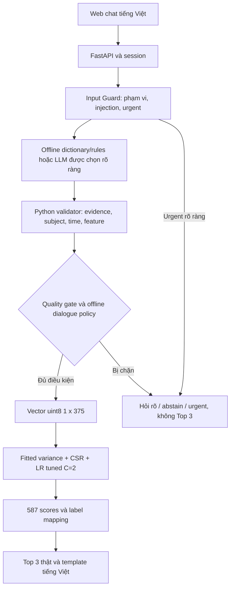

# Kiến trúc hệ thống

## Hợp đồng review thuật ngữ — 2026-11-04

Tách candidate metadata `proposed_display_vi`, `proposed_aliases_vi`, semantic_notes/confidence/review_status/source_status/reference_scope khỏi các trường runtime `display_vi`, `aliases_vi`, `aliases_en`, activation_status và question flags. Bộ trích xuất không đọc proposed aliases. Chỉ cập nhật metadata/bảng review, giữ nguyên signature các trường runtime:5fcbf9e743088a41d009abc3ee9fb310ab040aa9e814dce72e3dae9953f5644e. Canonical375keys/order giữ nguyên. Không có cơ chế tự chuyển READY thành active.

READY là mức sẵn sàng của đề xuất ngôn ngữ/kiểm tra kỹ thuật, yêu cầu confidenceHIGH; AMBIGUOUS yêu cầuLOW. REVIEW và HIGH_RISK_COLLISION giữ nhu cầu review phạm vi hoặc collision. needs_review là cờ cần người duyệt, clinical_review luôn NOT_CLINICALLY_VALIDATED; nguồn tham khảo không tự cấp approval. production_activation độc lập với các cờ đó. Script report phân tích collision của toàn bộ proposed catalog riêng với135alias features đang active; không trình bày collision pending thành lỗi runtime hiện tại.

Full review375 hiện có266READY/56REVIEW/27AMBIGUOUS/26HIGH_RISK_COLLISION,145READY cònpending. Production vẫn135active/240pending. Xem DEPLOYMENT_GUIDE cho quyết định còn thiếu và các bảng. Test synthetic chỉ kiểm ngôn ngữ/quy tắc/evidence, không chứng minh đủ an toàn lâm sàng hoặc độ chính xác extraction trên người dùng thật. Accuracy của cả tập test tiếp tục nằm ngoài Top3rows; source/checkpoint binding và numeric scores không đổi.

## Continuity và user-requested preview — cập nhật hiện hành

ChatRequest thêm action=message/more/preview, mặc địnhmessage để tương thích caller cũ. Controls không trộn với message/reset; backend chỉ thực hiện trên OfflineConversation. Control là ý định người dùng, không được thêm thành evidence triệu chứng trong history. Giữ session lock, TTL, subject/epoch, counters và cùng PredictionService. Action more/preview có thể gõ bằng câu điều khiển chính xác hoặc dùng nút UI. Online/provider cũ không bị gọi bởi controls offline.

Vòng hỏi lưu round, round_start_questions và round_start_batches trong extension của session; số câu/batch tổng vẫn tích lũy. More được mở tối đa2vòng có chủ đích, không reset asked/states/bindings. User/control turns tổng24. Selector chỉ chọn nhóm liên quan đến present hoặc nhóm tổng quát, không lấy các nhóm bộ phận không liên quan chỉ để tăng điểm. Lý do hết vòng/no_relevant_questions được trả rõ; người dùng có thể bổ sung hoặc xem preview. Không tự sinh limited prediction từ nhánh hết budget; inference tự động chỉ theo policy đủ dữ kiện và canonical gate hiện hành. Đây là policy nghiên cứu, không chứng minh đủ thông tin lâm sàng.

Preview đi qua việc kiểm lại extraction/evidence gốc và validator.gate/frame(min_present_features=1), chỉ khi người dùng yêu cầu; Policy.min_present_features=2 và tự động min3present/3answered giữ nguyên. Không bỏ các gate khác. Trạng thái answer_error, alias clarification, uncertain, conflict, unmapped hoặc urgent/stopped chặn preview; dữ kiện cũ trước unsupported health không được dùng để lách gate. Ready frame hiện hành vẫn qua forward_ready và loader/inference integrity. Model scores không quyết định được phép preview và không bị điều chỉnh.

Dictionary tương thích cũ, thêm activation_status/semantic_notes/confidence/review_status. aliases_vi chứa đề xuất cho375feature, nhưng extractor chỉ đưa Việt ACTIVE_EXISTING (135feature) vào matching index;240PENDING_REVIEW không được dùng tự động. Canonical English aliases vẫn giữ theo hợp đồng hiện có. Question eligibility cũng loại pending. Folded collisions đang hoạt động vẫn phải disambiguate; report còn phân tích toàn bộ proposals/near-feature risks, không đồng nhất coverage đề xuất với production. LOW/nhãn tổng hợp chỉ có candidate cần review. Không có API dịch hoặc fuzzy map.

Presentation giữ numeric Top3/raw score_label lịch sử, thêm confidence_label/confidence_note/model_evaluation. Metric Accuracy được lấy từ frozen closeout packet có checksum đã biết, gắn đúng model_id/checkpoint hash; thiếu evidence không chặn ML nhưng chỉ hiển thị benchmark NOT VERIFIED. Frontend hiện Accuracy một lần ở tiêu đề, giải thích scope toàn test split, không phải correctness của prediction hiện tại. Không đọc payload test hoặc suy ra accuracy từ score. Nguồn bằng chứng và quyết định model không đổi.

## Offline V2 — hiện hành 2026-11-04

Giữ `OfflineExtractor → ExtractionValidator → OfflineConversation → LRPredictionService` và session manager hiện có. `configs/phase5b.json.offline.dialogue_version=2` bật V2; mặc định của class vẫn hỗ trợ V1 để kiểm regression và caller cũ. Không đổi fitted pipeline, schema375/class order587, checkpoint hoặc bootstrap. `answer_bindings` chỉ là proof server-side gắn câu trả lời vào câu hỏi đã phát; không phải trường được chấp nhận trong JSON extraction hoặc API input.

Batch mặc định 3 feature, cấu hình 1/3/5; tối đa 4 batch và 12 câu hỏi riêng, giới hạn user turns vẫn 12. Câu hỏi chọn từ 43 feature có cách diễn đạt Việt được khai báo rõ, ưu tiên cùng nhóm ngữ cảnh với present features rồi priority/schema order. Các nhóm là heuristic ngôn ngữ cần review, không phải chẩn đoán, không lấy hệ số LR hoặc score để dẫn dắt. Không hỏi lại state đã biết/feature đã hỏi. Collision vẫn làm rõ riêng và tiêu thụ budget câu hỏi.

Mỗi pending batch có ID ngẫu nhiên, session epoch, subject, ordinal ổn định, feature/text/state. Trả lời theo số bắt buộc có batch_id hiện hành; UI gửi chuỗi số/state và ID, không gửi feature tùy ý. Parser chỉ nhận cú pháp giới hạn; trả lời thiếu giữ pending. “Có” không thể trả lời cả batch nhiều mục. “Không có cái nào” phủ định batch hiện hành chưa trả lời; “không biết/không rõ” là uncertain. Nếu batch đã trả lời một phần, các câu khái quát này cần làm rõ phạm vi bằng số thứ tự, không tự sửa câu trả lời trước hoặc đoán phạm vi còn lại. Trả lời tự do vẫn qua extractor; câu hỏi assistant không được dùng làm evidence. Validator kiểm span gốc/subject/time và proof đúng feature/state, kể cả câu trả lời nhóm dùng chung span. Reset/chuyển chủ thể/cập nhật rõ vô hiệu pending/proof; mọi lượt vô hiệu ready frame trước xử lý. Không ghi key hoặc nội dung hội thoại vào persistent storage.

V2 chỉ dự đoán khi canonical gate qua, không còn mục batch chưa trả lời, đạt ít nhất 3 present và 3 câu hỏi đã trả lời. Nếu cần hỏi thêm nhưng hết budget/ứng viên, dưới 3 present sẽ `offline_v2_insufficient`; từ 3 present có thể `offline_limited_v2_budget` nếu canonical gate vẫn qua. Đây là policy tạm thời, không phải tiêu chí đủ thông tin lâm sàng; không dùng threshold score. Uncertainty/conflict/unmapped vẫn chặn. Sau kết quả có thể bổ sung/sửa triệu chứng và dự đoán được tính lại; UI đánh dấu kết quả cũ là lịch sử.

API bổ sung `/api/v1/models` chỉ công bố LR tuned được duyệt, artifact/hash/provenance và availability từ loader thực; không load các model khác. ChatRequest thêm model_id cố định, mode, batch_id; response thêm pending_questions và counters. Online trong UI chỉ là xem trước cài đặt, chưa hỗ trợ kết nối server; mode=llm bị từ chối, key không được gửi/lưu. Adapter LLM cũ vẫn tồn tại, chỉ bật qua cấu hình server riêng; không fallback tự động. Frontend luôn yêu cầu offline rõ ràng, nên server chạy LLM không được âm thầm xử lý yêu cầu offline.

Từ điển: 136/375 feature có alias Việt; 230 MISSING và 9 AMBIGUOUS, tất cả vẫn needs_review. Nhãn bệnh: 2 REVIEWED bằng đối chiếu thuật ngữ, 581 DRAFT, 4 AMBIGUOUS, 0 MISSING. Ba phê duyệt hiển thị trước đây vẫn giữ provenance, không đồng nhất với review thuật ngữ hoặc thẩm định bác sĩ. Báo cáo `scripts/build_synonyms_report.py` phân biệt hai loại trạng thái.

Nguyên mẫu nghiên cứu phân loại bệnh từ triệu chứng nhị phân. **LR tuned C=2 đã được chọn trước final test**. Prediction API và website localhost có chế độ quy tắc offline độc lập; các provider LLM vẫn là tùy chọn và chưa có bằng chứng end-to-end live thành công. Không coi kết quả là chẩn đoán hoặc hiệu quả lâm sàng đã xác thực.

## Luồng đang triển khai

Response hiện tại dùng template Python có kiểm soát, không cần LLM diễn giải bệnh. Trong chế độ LLM, provider chỉ hỗ trợ hiểu văn bản; không chọn bệnh, sinh scores hoặc suy triệu chứng từ nhãn bệnh. `/api/v1/predict` nhận input có cấu trúc riêng, không gọi Gemini và không thay thế quality gate hội thoại.

## Trách nhiệm và source

| Thành phần | Source | Hợp đồng |
|---|---|---|
| Catalog, validator, mapper | [extraction.py](../src/agent/extraction.py) | Exact feature names, schema ID, evidence span từ user, chủ thể/thời điểm; frame đúng thứ tự |
| Guard và state | [conversation.py](../src/agent/conversation.py) | Correction/negation, TTL, clarification và vô hiệu kết quả cũ |
| External provider | [provider.py](../src/agent/provider.py) | REST Interactions, structured output, bounded errors/usage; key chỉ backend |
| LR service | [prediction.py](../app/backend/prediction.py) | Kiểm 7 artifact, source pins, environment và fitted pipeline; load một lần, không fallback |
| Chat/API | [chat.py](../app/backend/chat.py), [main.py](../app/backend/main.py) | Chỉ forward_ready mới vào LR; provider/model lỗi không có Top 3 |
| Frontend | [app/frontend](../app/frontend/) | Session ID trong RAM, hỏi rõ/reset; giữ scores và nhãn backend |
| Colab bootstrap | [colab_runtime.py](../src/data/colab_runtime.py) | Verify published payload, copy source vào VM; data/artifact ở Drive |

## Dữ liệu và pipeline cố định

Input **375 feature** theo [schema](../../disease-prediction-ml-data/artifacts/metadata/phase2/feature_schema.json), **587 lớp** theo [mapping](../../disease-prediction-ml-data/artifacts/metadata/phase2/label_mapping.json). Không thêm feature vào schema ML, đổi ordering hoặc thêm lại regurgitation/regurgitation.1.

1 = ghi nhận hiện diện; 0 = chưa ghi nhận hiện diện, không phải âm tính lâm sàng. Denied, uncertain, unmentioned, unmapped và conflict được giữ ngoài vector. Fitted pipeline `VarianceThreshold(0) → FunctionTransformer(to_csr) → LogisticRegression` giữ 318 feature sau variance. Inference không fit lại mask/encoder/tham số.

Có feature hợp lệ chưa đủ để dự đoán. Invalid extraction, thiếu thông tin, conflict/uncertainty chưa giải quyết, urgent, provider failure, expiry hoặc model chưa sẵn sàng đều chặn Top 3. `min_present_features=2` là policy demo **provisional**, có cấu hình, không phải ngưỡng y khoa đã xác thực.

Gemini wire schema dùng đủ 375 mã f000…f374; adapter exact-decode về tên canonical trước validator. Không giảm feature ML hoặc fuzzy-map. Mitigation serving schema này **chưa live-verified**.

Scores là predict_proba thật trên 587 lớp; Top 3 ×100, không chuẩn hóa lại. UI ghi **Điểm mô hình (%)**, calibrated=false; không gọi là xác suất mắc bệnh. Tie giữ thứ tự lớp Phase 2.

## Session và runtime

Session in-memory, một process/worker; reset không reset provider budget. UUID không là xác thực hoặc kiến trúc production nhiều instance. Key không nằm trong frontend, source, notebook output hoặc log.

Windows là source chính/nơi chạy web. Drive là persistent data/checkpoint/evidence; Colab VM/cache là tạm. Code Windows không tự xuất hiện trên VM: cần publish payload nhỏ bằng helper hiện có. Xem [triển khai](DEPLOYMENT_GUIDE.md), [bàn giao](HANDOVER_GUIDE.md), [đặc tả Phase 5](phase5_llm_integration_design.md).

[ML_EXPERIMENTS](ML_EXPERIMENTS.md) ghi kết quả và giới hạn; [DEVELOPMENT_LOG](DEVELOPMENT_LOG.md) ghi tiến trình/bằng chứng. [Thiết kế v1](archive/integration/SYSTEM_ARCHITECTURE.md) là lịch sử, không phải trạng thái hiện hành.

## Chat offline — cập nhật 2026-11-02

`DISEASE_CHAT_MODE=offline` chọn `src/agent/offline.py`: từ điển → matching toàn cụm → canonical extraction v2 → validator/gate/session cũ → LR service cũ → template. Không khởi tạo BoundedProvider, không key, không HTTP ngoài và không fallback. Không đổi 375 feature, 587 label hoặc fitted preprocessing. Không có classifier hay inference pipeline song song.

`OfflineExtractor` cung cấp cùng giao diện generate; `OfflineConversation` chỉ mở rộng câu hỏi cố định và pending reply. `SessionStore`, TTL/reset, stale-vector protection, giới hạn lượt/câu hỏi và `forward_ready` được tái sử dụng. Cue phủ định/chủ thể/thời gian có thêm dạng không dấu trong canonical validator, vẫn kiểm exact evidence trên văn bản gốc. NFC/NFD được kiểm thử; alias được ánh xạ ngược về Unicode offsets ban đầu.

`configs/synonyms.json` có đủ 375 khóa canonical; 45 feature có alias Việt (12%), 330 chưa có. Toàn bộ 375 mục needs_review=true: bản nháp chưa phải thuật ngữ y khoa đã review. Tên Anh giữ nguyên làm alias chính xác. Matching ưu tiên cụm dài, có ranh giới từ, không fuzzy. Có dấu phân biệt đau cơ/đau cổ; không dấu `dau co` giữ ambiguous. Chỉ present thành 1; denied/uncertain/unmentioned được phân biệt trong sidecar, không gộp trong state. Unmapped/uncertain/conflict chặn Top3.

Câu hỏi dùng thứ tự cố định fever/cough/headache/nausea, bỏ qua feature đã biết/đã hỏi; không dùng score hay tên bệnh để dẫn dắt. Câu trả lời ngắn chỉ cập nhật feature của pending question, không tự giả định. Min_present_features=2 vẫn provisional, không phải ngưỡng y khoa; không thêm confidence/margin threshold. Explicit correction/current-time update yêu cầu bằng chứng mới theo contract hiện có, không giữ các triệu chứng cũ chưa tái xác nhận. Người dùng nên mô tả lại toàn bộ trạng thái hiện tại khi sửa.

Mặc định offline khi không có cấu hình provider rõ ràng. Để bảo toàn cấu hình LLM cũ, DISEASE_LLM_PROVIDER được đặt rõ ràng vẫn chọn nhánh LLM nếu chưa đặt DISEASE_CHAT_MODE; biến mode=offline luôn ưu tiên và không khởi tạo provider dù key/live flags còn trong terminal. Chọn mode=llm mới dùng các adapter Gemini/Groq/OpenRouter hiện có; không tự routing/fallback.

### Offline follow-up và alias clarification — 2026-11-02

Policy hội thoại offline được đánh giá sau canonical extraction/gate và trước `forward_ready`; việc LR có thể trả predict_proba không cấp quyền hiển thị Top3. `offline.ask_when_present_at_most=2` trong configs/phase5b.json yêu cầu hỏi tiếp khi có tối đa hai present và còn câu hỏi hợp lệ. Ngân sách dùng nguyên `conversation.max_clarification_turns=2`, tính cả câu hỏi collision và clarification; `conversation.min_present_features=2` giữ nguyên. Ba present có thể qua policy mặc định; đây là heuristic hỏi đáp, không phải ngưỡng y khoa/độ tin cậy. Không dùng ngưỡng score/margin hoặc coefficients để chọn câu hỏi.

Selector thử `offline.question_priority` rồi fallback theo thứ tự schema trong những feature chưa biết/chưa hỏi, có display Việt thực (khác placeholder tiếng Anh). Một feature có display hợp lệ vẫn có thể được hỏi dù thiếu aliases_vi; hỏi không làm nó thành present. Không dùng vị trí coef_318 để index schema375. Thiếu display hoặc toàn bộ ứng viên đã biết/đã hỏi được phản ánh bằng selector reason; không ép Top3. Khi hết budget/ứng viên: chỉ canonical-gate-passed mới có SHOW_LIMITED_RESULT với cảnh báo; chưa đủ gate thì abstain. Các reason chính: offline_collect_more, offline_alias_collision, offline_limited_question_budget, offline_limited_no_eligible_question, offline_insufficient_question_budget, offline_insufficient_no_eligible_question, offline_collision_unresolved. HTTP giữ status prediction_ready cho kết quả thực để không đổi frontend contract; limited được thể hiện qua reason và warning trong message.

Dictionary có hai index: alias gốc NFC/casefold và alias bỏ dấu. Matching xét từng cụm, không dựa vào cả câu: đau cơ→muscle pain; đau cổ→neck pain; dau co→hai candidate, không gán. Không sửa synonyms.json vì dạng có dấu và collision flag đã đúng. Session hiện có giữ pending_clarification gồm candidate canonical names, state, subject và exact evidence. Chọn tên rõ dấu hoặc cái đầu/cái thứ hai chỉ giải nghĩa mention cũ; denied/uncertain không bị nâng thành present. Resolution liên kết turn+offset+subject và lượt trả lời, giữ evidence original; không viết lại user text và không hạ validator. Reset/TTL/subject update không mang clarification sang ngữ cảnh mới. Có/không khi đang hỏi nghĩa của dau co không phải lựa chọn feature.

Structured debug tắt mặc định, bật `offline.debug_logging=true`: event offline_policy/offline_prediction, hash session, action/reason, present count, asked/remaining budget, pending flag, selector reason; chỉ có số Top3 nếu đã tính. Không log user text, feature list, disease labels, credentials hay raw session ID. Logger thông thường ghi stderr khi host chưa có handler; không ghi file evidence mới.

### Health intent và presentation — cập nhật 2026-11-02

HealthIntentDetector trong offline.py nhận keyword/body terms/question phrases từ offline section của configs/phase5b.json, không phụ thuộc Catalog hay vector ML. So khớp theo ranh giới cụm, hỗ trợ không dấu/NFD và giữ khác biệt dấu khi rõ (họ≠ho, thuộc≠thuốc). Metadata context tách self/other/hypothetical/quoted/unspecified. Health intent không chứng minh symptom present; từ bệnh/cancer/pregnancy không tự sinh feature. Urgent/injection/input validity vẫn có ưu tiên; pending reply và canonical extraction/evidence validation vẫn dùng luồng cũ. Câu không có mô tả symptom hợp lệ nhưng có health intent trả unsupported_health, không out_of_scope và không Top3. Câu hiện tại không liên quan vẫn out_of_scope dù session trước nói sức khỏe. Mixed supported/unmapped health giữ states đã validate và unmapped trong sidecar, nhưng chưa được suy luận. Không tự chọn câu hỏi từ LR coefficients cho khối u/mang thai; template yêu cầu mô tả triệu chứng thực và nêu giới hạn 587 nhãn.

PredictionPresenter trong src/agent/presentation.py chỉ thêm presentation metadata vào bản sao kết quả. Không sửa TopResult.label/class_id/score_percent, model probabilities hoặc thứ tự. configs/disease_names_vi.json có đủ 587 canonical keys, không thay label_mapping. needs_review=false và display_vi hợp lệ mới được ưu tiên; missing/unreviewed giữ canonical English và cảnh báo. Hiện 0 reviewed, 587 needs_review, 0 missing entry; 5 bản dịch nháp, 582 placeholder giữ tên gốc. Không tuyên bố bản dịch y khoa đã được duyệt.

configs/phase5b.json.presentation.SCORE_DECIMALS=4. score_percent sẵn ở thang 0–100, presenter chỉ format thành score_text, không nhân thêm100 hay renormalize. API trả nguyên số cùng presentation.top3/canonical_label/display_label/translation_status/score_text; chat có state_summary.top3_display dùng cùng metadata. Frontend ưu tiên score_text từ backend (tránh khác half-way rounding Python/JS), giữ layout, chỉ dùng toFixed khi tương thích response cũ; mọi score phải finite/in-range. Terminal demo dùng cùng presentation. Debug mặc định OFF, chỉ bổ sung health context/cue reason, matched/unmatched counts và translation missing/review counts, không user text/labels/keys.

### Bản dịch tham khảo được phép hiển thị (2026-11-02)

Chính sách hiện hành của đồ án mở presentation.ALLOW_DRAFT_TRANSLATIONS=true theo lựa chọn rõ ràng của phụ trách dự án. Không thay needs_review=true thành false cho toàn bộ danh mục: 580 bản nháp hiển thị với status=draft/cảnh báo chưa được chuyên gia rà soát; 3 tên đã được chấp thuận hiển thị vẫn không là bằng chứng review y khoa. Tổng 583/587 có tên Việt, 4 nhãn mơ hồ giữ gốc với note. Presenter mặc định strict khi được khởi tạo không opt-in; tắt config khôi phục fallback canonical cho draft. UI chỉ mở rộng display status draft, không thay vector/model/numeric scores hoặc quality gate. Quy tắc chỉ dùng reviewed ở giai đoạn trước là lịch sử, không còn là cấu hình display hiện hành.

## Model selection runtime — 2026-11-11

`app/backend/models.py` khai báo ba ứng viên frozen, load từng candidate qua checksum/source/env guard của loader hiện có. Default vẫn LR tunedC2; startup không fallback. API registry tách available/reason của từng model; chỉ comparator được qualify mới phục vụ. Trên Windows3.13.17 hiện chỉ LR tuned được enable. Hard voting reuse fitted LR/SVC/KNN và engine đã pin, không estimator training mới.

`/predict` thêm model_id tùy chọn; LR giữ Top3contract, hard trả hard_vote_result riêng. `/chat` dùng cùng offline extractor/qualitygate nhưng dialogue store riêng cho từng model, chặn session chéo409 và reset context khi đổi model. Backend trả model thực xử lý; UI chặn response không khớp lựa chọn. Hard không có Top3 probability. Notebook source/outputs,375feature/318retained/587labels/135active không đổi.
