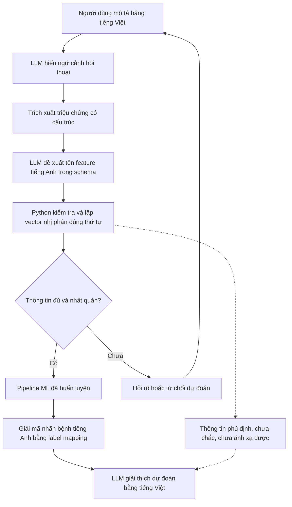

> ARCHIVE — Bản tại thời điểm trước hợp nhất tài liệu. Các trạng thái và lệnh cũ không phải hướng dẫn hiện hành. Xem [chỉ mục hiện hành](../../README.md) và [triển khai](../../DEPLOYMENT_GUIDE.md). Đường dẫn trong code block vẫn tính từ project root.

# Kiến trúc LLM–ML và hợp đồng giao tiếp

Cập nhật 2026-10-28 theo phản hồi giảng viên được người dùng cung cấp. Đây là **thiết kế cho giai đoạn tích hợp sau này**, chưa phải chatbot đã triển khai. Mục tiêu là nguyên mẫu học thuật: LLM hiểu lời kể tiếng Việt, ML phân loại trên schema triệu chứng đã khóa, LLM diễn đạt kết quả bằng tiếng Việt. Chưa có xác thực chẩn đoán lâm sàng.

**Sau Phase4:** chọn prefitted Logistic Regression làm mặc định theo validation, chưa đánh giá locked test. [Thiết kế Phase5](phase5_llm_integration_design.md) là đặc tả chi tiết hiện hành: external LLM API cho trích xuất/diễn đạt, extraction contract đề xuất v2, Top3 score từ LR thật và nhánh hỏi rõ/abstain/urgent. Hợp đồng v1 bên dưới giữ vai trò thiết kế ban đầu; phần score được mở rộng có kiểm soát trong Phase5, không coi là xác suất mắc bệnh.

## Luồng xử lý dự kiến

Mũi tên là hợp đồng dữ liệu, chưa phải endpoint hoặc hàm được cài đặt. LLM không được chọn bệnh thay classifier. Không cần PCA, embedding bảng hoặc đặc trưng mới để thực hiện luồng này.

## Trách nhiệm và giới hạn thành phần

| Thành phần | Đầu vào → đầu ra | Trách nhiệm |
|---|---|---|
| LLM hiểu và trích xuất | Văn bản/ngữ cảnh tiếng Việt → `SymptomExtraction` | Phân biệt khẳng định, phủ định, chưa chắc và chưa ánh xạ; chỉ lấy triệu chứng có bằng chứng trong lời kể. Không suy triệu chứng từ bệnh nghi ngờ hoặc tự nhận lời kể là chẩn đoán. |
| LLM chuẩn hóa tên | Khái niệm triệu chứng → tên tiếng Anh thuộc `features` | Đề xuất ánh xạ theo danh sách schema; khái niệm không khớp chuyển sang `unmapped`, không phát minh tên cột. |
| Python mapper tất định | `SymptomExtraction` + schema → `FeatureInput` hoặc yêu cầu hỏi rõ | Xác thực cấu trúc/tên/trạng thái, kiểm mâu thuẫn và tạo vector theo đúng thứ tự. Không dùng fuzzy matching để âm thầm sửa tên. |
| ML classifier | Vector → mã lớp từ pipeline đã fit | Chịu trách nhiệm phân loại; chỉ trả lớp thuộc mapping đã khóa. Không nhận văn bản tự do hoặc diễn giải do LLM tạo thành đặc trưng mới. |
| Python giải mã và kiểm đầu ra | Mã lớp + label mapping → `PredictionResult` | Đối chiếu danh tính model/schema/mapping, giải mã chính xác, kiểm score nếu có; không tạo mapping mới theo phiên chạy. |
| LLM tạo phản hồi | `PredictionResult` thực + thông tin trích xuất đã kiểm → tiếng Việt | Giải thích nhãn thực nhận, nêu giới hạn; không thêm bệnh/triệu chứng hoặc phần trăm tin cậy ngoài payload. Không gọi dự đoán là chẩn đoán xác nhận. |

## Artifact bắt buộc tái sử dụng

Đường dẫn tính từ persistent storage root; nguồn schema của inference là bộ Phase 2 đã khóa, không phải danh sách viết tay:

- [feature_schema.json](../../../../disease-prediction-ml-data/artifacts/metadata/phase2/feature_schema.json): `features` có **375** tên đúng thứ tự, `allowed_values=[0,1]`, dtype `uint8`, schema version 1; schema SHA `441709695f8b878e65d848309361838fa0367b6c031ed665a1472a9aee43b734`.
- [label_mapping.json](../../../../disease-prediction-ml-data/artifacts/metadata/phase2/label_mapping.json): **587** nhãn nguyên bản, `class_to_id` và `id_to_class`, mã 0-based cố định. LLM không dịch nhãn rồi dùng bản dịch làm khóa phân loại.
- [preprocessing_policy.json](../../../../disease-prediction-ml-data/artifacts/metadata/phase2/preprocessing_policy.json) và [dataset_manifest.json](../../../../disease-prediction-ml-data/artifacts/metadata/phase2/dataset_manifest.json): ý nghĩa 0/1, hai cột bị loại, fingerprint và checksum các artifact.
- Pipeline đã fit và metadata Phase3: năm checkpoint đã được audit trên Colab qua evidence người dùng cung cấp, không có bản model local. Model mặc định là `artifacts/models/phase3/baseline-v1-f8a5bfdb7b4c12cd/logistic_regression/pipeline.joblib` trên storage đã cấu hình. [Code checkpoint hiện có](../../../src/models/training.py) kiểm identity/checksum; dùng nguyên fitted pipeline, không tạo model mới. [Kết quả chọn model](../ml/phase4_ensemble.md).

Input model là 375 cột **trước** variance removal. Tái sử dụng toàn bộ fitted pipeline `VarianceThreshold(0) → CSR → estimator`; không tự bỏ cột hằng, fit lại transformer hoặc thêm lại `regurgitation`/`regurgitation.1` khi suy luận. Không đưa nhãn `diseases`, group ID hay trạng thái hội thoại vào vector. Thứ tự CSV có nhãn ở cuối không phải danh sách input model: lấy riêng `features`.

## Hợp đồng dữ liệu đề xuất v1

Các tên dưới đây mô tả interface cho phase tích hợp; chưa có module/API tương ứng được triển khai.

| Interface | Trường và điều kiện |
|---|---|
| `extract_symptoms(context, allowed_features) → SymptomExtraction` | `contract_version=1`, `schema_sha256`; `symptoms` là danh sách `{feature, assertion, evidence_refs}`; `assertion` chỉ nhận `affirmed`, `denied`, `uncertain`. `evidence_refs` tham chiếu lượt nói và đoạn văn bản người dùng trong phiên, không phải suy luận của LLM. `unmapped` chứa `{concept_vi, assertion, evidence_refs}`; `clarification_needed` là boolean. Không có trường nhãn bệnh do LLM chọn. |
| `map_features(extraction, schema) → FeatureInput` | `status` thuộc `ready`, `needs_clarification`, `abstain`, `invalid`; khi ready có vector 1×375 nhị phân, `feature_order=schema.features`, schema hash và sidecar gồm `affirmed`, `denied`, `uncertain`, `unmentioned`, `unmapped`, `conflicts`. Khi chưa ready, vector dùng cho classifier phải là `null`. |
| `classify(feature_input, fitted_pipeline, label_mapping) → PredictionResult` | Chỉ chạy khi ready và checkpoint/schema/mapping identity khớp. Kết quả có `status=predicted`, `model_id`, schema/mapping identity, `label_id`, `label_en`, `score=null` mặc định. Mã lớp ngoài mapping là lỗi, không nhờ LLM sửa. Trạng thái không dự đoán giữ `label_id`, `label_en`, `score` là `null` và có `reason`. |
| `render_response(prediction, extraction_summary) → VietnameseResponse` | `status` là predicted/needs_clarification/abstain; tiếng Việt chỉ diễn đạt đúng `label_en` đã nhận. Bản dịch chưa rõ thì giữ tên tiếng Anh và nói rõ; không tạo thêm nhãn thay thế. Khi không có prediction thì chỉ hỏi rõ/từ chối, không lấp khoảng trống bằng bệnh do LLM đoán. |

Kiểm tra JSON phải từ chối sai kiểu, enum/trường không được phép, hash/schema khác phiên bản, tên feature ngoài allowlist, evidence không có trong ngữ cảnh, và cùng feature có trạng thái trái nhau chưa giải quyết. `unmapped` hợp lệ để lưu khái niệm chưa khớp; không đưa nội dung này vào vector. Triệu chứng của người khác, quá khứ hoặc giả định phải được xác định đúng chủ thể/thời điểm; nếu chưa rõ, hỏi lại. Không có quy tắc tự ghi đè phủ định bằng khẳng định mới nhất khi ngữ cảnh chưa rõ.

### Mã hóa 0/1 và thông tin còn thiếu

Đây là quy tắc mapper **dự kiến**, tuân theo ý nghĩa nhị phân đã duyệt ở Phase 2, không thay schema:

| Tình trạng sau xác thực | Giá trị input | Thông tin giữ riêng |
|---|---:|---|
| `affirmed`, ánh xạ chắc chắn vào schema | 1 | Bằng chứng từ lời kể |
| `denied` | 0 | Đã phủ định rõ |
| `uncertain` | 0 | Chưa đủ cơ sở ghi nhận hiện diện; có thể cần hỏi rõ |
| Không nhắc tới | 0 | Chưa hỏi/chưa biết; tuyệt đối không gọi là đã phủ định |
| Chưa ánh xạ hoặc mâu thuẫn | Không thêm cột | Khái niệm/mâu thuẫn và lý do hỏi rõ |

Giá trị 0 chỉ mang nghĩa **chưa ghi nhận hiện diện**. Vector không giữ được khác biệt phủ định/chưa chắc/chưa nhắc; sidecar giữ khác biệt này cho đối thoại, không mở rộng input model. Nếu chưa có triệu chứng affirmed ánh xạ được, có mâu thuẫn chưa giải quyết hoặc ý nghĩa ánh xạ không đáng tin, không gọi classifier. Một triệu chứng đơn lẻ không tự chứng minh đủ thông tin; tiêu chí chất lượng khác và ngưỡng abstention phải được thiết kế/đánh giá ở phase tích hợp, chưa chốt số tùy ý trong tài liệu này.

Ví dụ hoàn toàn giả định để mô tả hợp đồng: “Tôi ho, không sốt, chưa rõ có buồn nôn không” → `cough=affirmed`, `fever=denied`, `nausea=uncertain`; chỉ `cough` nhận 1. Các cột còn lại nhận 0 theo quy ước ghi nhận, không được mô tả thành hàng trăm triệu chứng đã hỏi và phủ nhận. Đây không phải văn bản người dùng thật hoặc kết quả thử nghiệm.

### Nhãn và score

`label_id` phải là mã model thật trả về, `label_en=id_to_class[label_id]`; metadata và `pipeline.classes_` phải khớp mapping. Không huấn luyện lại LabelEncoder hoặc gọi LLM để chọn một nhãn có vẻ hợp lý hơn.

Có `predict_proba` chưa đủ để công bố xác suất đáng tin; xác suất cần được kiểm tra calibration trên dữ liệu phát triển độc lập phù hợp. `LinearSVC.decision_function` là margin, không phải xác suất. Hợp đồng tương lai chỉ cho phép `score={kind, value, label_id, validation_reference}` sau khi loại score và bằng chứng đánh giá đã được duyệt; nếu chưa thì giữ `null`. Không biến softmax của margin thành “% mắc bệnh”, không chuyển độ tự tin tự khai của LLM thành độ tin cậy ML. Tham khảo [calibration](https://scikit-learn.org/stable/modules/calibration.html) và [LinearSVC](https://scikit-learn.org/stable/modules/generated/sklearn.svm.LinearSVC.html).

Phản hồi có thể nói “Mô hình gợi ý … dựa trên các triệu chứng được ghi nhận; đây chưa phải chẩn đoán xác nhận”. Không bịa cơ chế bệnh hoặc quan hệ nhân quả để giải thích vì sao model chọn nhãn. Chỉ được nêu đóng góp đặc trưng nếu sau này có phương pháp giải thích đã kiểm chứng và payload tương ứng.

## Ranh giới triển khai và kiểm tra sau này

Hiện có: audit/EDA, preprocessing đã khóa, loader, năm checkpoint đã audit, Phase4 và structured inference Colab, pipeline training và bootstrap Colab/Drive. Phase5B đã có ba module trong `src/agent/` cho Gemini adapter, guard, v2 validator/mapper và hội thoại có giới hạn; chỉ kiểm offline, **LIVE NOT VERIFIED**. Phase5A chưa có Prediction API; dùng protocol/mock, không thêm loader hoặc endpoint. [Cấu hình/cách chạy và giới hạn Phase5B](phase5_llm_integration_design.md#8-phase5b-đã-triển-khai--cách-chạy-và-ranh-giới). Giữ nguyên [bootstrap Colab hiện hành](../runtime/phase3_colab.md).

Kiểm offline đã có cho phủ định/chưa chắc/context cue rõ,375 cột, hai cột đã loại, hỏi rõ/abstain, state/TTL và stale vector. Chưa có kết quả LLM extraction thật, human-reviewed evaluation hoặc tích hợp fitted LR/response tiếng Việt trong Phase5B. Bộ30 ca tổng hợp vẫn pending_human_review; các contract v1 ở trên là thiết kế lịch sử, v2/implementation hiện hành nằm trong tài liệu Phase5.

Tiến độ theo phase và bằng chứng ở [nhật ký phát triển duy nhất](../planning/PROJECT_DEVELOPMENT_LOG.md); lý do chọn classifier ở [tài liệu mô hình](../ml/MODEL_SELECTION_RATIONALE.md).
