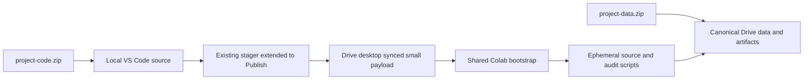

> ARCHIVE — Bản tại thời điểm trước hợp nhất tài liệu. Các trạng thái và lệnh cũ không phải hướng dẫn hiện hành. Xem [chỉ mục hiện hành](../../README.md) và [triển khai](../../DEPLOYMENT_GUIDE.md). Đường dẫn trong code block vẫn tính từ project root.

# Local code + Drive data — kế hoạch phân phối hai ZIP

## Trạng thái triển khai 2026-10-30

**IMPLEMENTED / LOCAL VERIFIED; COLAB CLOUD NOT VERIFIED.** Owner đã cho phép implementation và đóng gói thử.
Helper `scripts/package_handover.py` dùng standard library cho code ZIP,source stage/publish,data plan/data ZIP vàsafe extraction.
`prepare_colab_source.ps1` gọi helper này;giữ existing shared bootstrap,không runtimeframework/Git/archive source thứ hai.
Hướng dẫn thực thi hiện hành ở [HANDOVER_GUIDE.md](HANDOVER_GUIDE.md#workflow-hiện-hành-2026-10-30).

- Runtime closure thực tế:45file=31src+8publicconfig+2requirements+4scripts (3audit vàpackage_handover).
  `configs/handover_data_requirements.json` chỉ chứa frozen IDs/hash/config requirements,không dataset/modelpayload.
- Staging immutable theo digest giữ nguyên staging cũ;Refresh không delete. Publish chỉ allowlist45paths,
  kiểmexistingcanonical suffix/approvedPhase2manifest/links/sourcepins trướcwrite,không ghi data/artifacts/reports.
- Generated runtime.json chứa44non-selffile entries vàpublicationdigest canonicalbase settings;
  bootstrap bắt buộc expected digest do local Publish cung cấp,kiểm45file trướccopy/import.
  Scripts/config update hay old/mixedrelease đều được phát hiện;source-onlyfingerprint cũ vẫn giữ nghĩa riêng.
- 8notebooks dùng cùng bootstrap vàdigestinput;03auditappendices dùngROOT/scripts vàguard thiếu session/api;
  output/cellIDs/execution_count/tuning switches03/04/05 được giữ nguyên. Session dùngColabTraining.open hiện có.
- Code ZIP có allowlist,secret/private-link checks,inventory,SHA và giải nén thử non-overwrite;
  release mới tạo dưới dist/handover,không zipdist/venv/cache/lockeddata/weights/reports.
- Data tool chỉ complete khi đủlockedPhase2Drivevariant,5+5checkpoints,referencedmanifest bundles,raw/processed,evidence/reports;
  dùngopaquehash/archive streaming cóexplicitflag,không parseCSV/NPZ/joblib hoặc gọiML.
  Data contract SHA đượcpin trongtool để không weakenrequiredfiles rồi gọipartialZIP làcomplete.
- Hiện không có confirmedDriveProjectPath/clientcloudack hoặc mountedColab trong phiênagent;
  data ZIP thật **NOT VERIFIED/NOT CREATED**,chỉ source/code ZIP vàsyntheticfixtures được kiểmlocal.
- GoogleDriveDesktop là một transport được hỗ trợ; owner hiện không dùng Desktop.
  Có thể chuyển nguyên folder staging nhỏ vào VM bằng extension và **chủ động** gọi publisher hiện có
  sau mount, ngoài smoke/06; không upload `.py` riêng hoặc tạo transport/framework khác.
  Xem [quy trình không có Desktop](HANDOVER_GUIDE.md#không-có-drive-for-desktop).
  Localcopyverified luôn báoCLOUD_ACK_PENDING; cần VM mới bootstrap từ Drive để kiểm persistence.
  Không tuyên bố đã publishCloud hoặc reloadcheckpoint thật. MLsource8pins+hardvoteengine,frozenfinalprotocol,375/587,LRtunedapproval không đổi.

Các hạn chế code-onlyintegrationtests vàlogicalDriveartifactlinks trong plan được giữ công khai;
standalone acceptance command là `python -B -m pytest -q -p no:cacheprovider tests/test_distribution.py`.
Releasechecksum/filecounts cụ thể nằm ởhandover_manifest.json của release thực tế,không tạoselfhash trongZIP.

**Sửa notebook ngày 2026-10-30:** smoke/06 khai báo digest rõ ràng trong setup, kiểm mount trước source,
tạo session riêng và báo blockers thay vì nối lỗi thiếu biến. Shared bootstrap/publisher/runtime closure
không đổi; notebook smoke không còn gọi loader train/validation hoặc chứa publisher.
Notebook 06 vẫn 14 cells, gate False, chỉ preflight; protocol/checkpoint pins không đổi.
Legacy notebook migrator giữ smoke flow đã review, tránh ghi đè trở lại smoke cũ.
Code ZIP hiện có được giữ nguyên, chưa chứa bản sửa notebook/docs này; không repack trong nhiệm vụ debug.
Đọc source staging/ZIP/fixture thành công không thay thế kiểm chứng Colab thật.

<details>
<summary>Bản audit/thiết kế ban đầu — các dòng CHƯA TRIỂN KHAI bên dưới là lịch sử trước implementation</summary>

Ngày **2026-10-30**. **AUDIT/PLAN ONLY — CHƯA TRIỂN KHAI PUBLISHER.**
Yêu cầu owner đã đính chính: chỉ giải nén `project-code.zip` local rồi mở VS Code;
chỉ `project-data.zip` upload Drive và giải nén vào canonical data/artifact root.
Không upload code ZIP, source ZIP thứ hai hoặc `.pyz` lên Drive. Không cần Git hosting.

Local source là nguồn phát triển chính; Drive là persistent data/model storage;
Colab VM là nơi tính toán tạm. Drive được phép chứa **bản publish nhỏ, sinh từ local code** để vận chuyển runtime source,
không phải nơi phát triển hoặc sửa code chính. Đề xuất bên dưới thay hướng dẫn upload từng `.py` khi được triển khai;
[handover guide cũ](HANDOVER_GUIDE.md) mô tả hệ thống đang chạy, chưa tự trở thành workflow mới.

## 1. Audit hiện trạng và nguyên nhân

Đã đọc [runtime.json](../../../configs/runtime.json),[shared bootstrap](../../../src/data/colab_runtime.py),
[ColabTraining](../../../src/models/notebook.py),[stager PowerShell](../../../scripts/prepare_colab_source.ps1),
8 notebooks00–06+smoke,script audit/build/migration,integrity/checkpoint loaders và source pins.
File kế hoạch này trước đó chưa tồn tại. Không truy cập Drive/kernel thật trong audit.

| Phát hiện thực tế | Bằng chứng/vị trí | Hệ quả |
|---|---|---|
| Stager chỉ chuẩn bị folder local,không publish network | `prepare_colab_source.ps1`: tham số chỉ Refresh/CheckOnly; cuối script yêu cầu upload CONTENTS | Mở code ZIP local không đưa code tới VM |
| Stager không có scripts | Inventory là src/*.py,7config,2requirements | Ba helper audit không đến Drive/runtime |
| Bootstrap bỏ scripts | `read_source` chỉ quét src,allowlist config,requirements; `copy_source` chỉ copy payload đó | Ngay cả script đặt trên Drive thủ công cũng chưa tự xuất hiện ở ROOT/scripts |
| Đường dẫn audit hardcode ephemeral | Notebook03 hiện21cell: cell18–19 dùng `/content/audit_post_tuning.py`;cell21 dùng thêm `/content/audit_final_ml_gaps.py` | Upload riêng bị lặp sau reset; khác ROOT do bootstrap tạo |
| Script cần session hiện có | Ba helper nhận `session`;ML_GAPS cần thêm `audit_api` | Upload script không tái tạo session; phải chạy setup/open session riêng |
| Phase5B config rơi khỏi copy | Stager có `configs/phase5b.json`,bootstrap PUBLIC_CONFIGS chưa có | Source agent có thể import nhưng thiếu config ở VM |
| Staging hiện cũ | 38file thực tế so40file hiện được stager yêu cầu;thiếu hai module final_evaluation | Không dùng staging cũ để bàn giao source mới |
| Fingerprint chưa là release check đầy đủ | `source_fingerprint` chỉ src/*.py;runtime.json hiện không pin expected_source_fingerprint | Hash copy bảo đảm copy nội bộ,không chứng minh đúng release local hoặc toàn bộ scripts/config |
| Remote không có filesystem Windows | Notebook kiểm Linux,/content và nạp source từ Drive | Kernel không thể trực tiếp import D: của VS Code |

Snapshot nhỏ chỉ đọc:31src Python=374.344bytes;7config=7.615bytes;2requirements=550bytes;
3audit scripts=68.232bytes. Đề xuất payload **43file,450.741bytes** theo source hiện tại, trước metadata publish sinh thêm trong runtime config.
Bootstrap hiện nhận39file,không có ba scripts và phase5b.json. Không chạy stager/Refresh/publish để sửa hiện trạng trong nhiệm vụ này.

Ba scripts giữ nguyên bytes/hashes để không làm đổi bằng chứng lịch sử:

| Helper phải publish cùng source | SHA-256 hiện có |
|---|---|
| `scripts/audit_phase3_results.py` | `52cf831d386476f07f1b28225e02bd7b27d72d62fdca228104307193484a314b` |
| `scripts/audit_post_tuning.py` | `98cb00071f72e3f3cdb045b618ae6cfa73eae5c30c339db9d989793315603235` |
| `scripts/audit_final_ml_gaps.py` | `7c925d48e02dfab7b6951303c2c3e69f52d4143658ba1e1976a079b5b4141ce1` |

Notebook dependencies:00–01 dùng data/evaluation modules+phase1/dataset_source;02 thêm preprocessing/phase2;
03 dùng ColabTraining/training/tuning và audit appendices;04 thêm ensemble/tuned_ensemble;
05 inference logic nằm trong notebook,dùng Phase4/checkpoint helper;06 dùng final_evaluation+frozen protocol;
smoke dùng bootstrap/phase2_preflight/smoke_test. Builders/migrators là công cụ local,không phải runtime dependencies.
Chỉ import/compile scripts không được tự gọi audit,benchmark,training hoặc evaluation.

## 2. Hợp đồng ownership của hai ZIP

**Chưa tạo hai ZIP;checksum archive chưa tồn tại.** Không coi workspace local hiện có là đủ để dựng data ZIP:
các weights/run bundles quan trọng chỉ được xác minh từ evidence Drive trước đây,không có bản local đầy đủ.

| Deliverable | Nội dung có chủ đích | Nơi giải nén |
|---|---|---|
| `project-code.zip` | Một folder `disease-prediction-ml/`:src,notebooks,scripts,public configs,tests,docs,app/backend,app/frontend,README,pyproject,requirements,setup.ps1,.gitignore;không có trained weights/dataset payload | Parent folder local do thành viên chọn;VS Code mở project folder này |
| `project-data.zip` | Entries phẳng `data/`,`artifacts/metadata/`,`artifacts/models/`,`reports/` theo inventory release được duyệt;raw/processed/needed interim,Phase1/2 metadata,5baseline+5tuned checkpoint,ensemble definitions/manifests,predictions,evidence và reports/figures/tables | **Bên trong** `MyDrive/ML_Projects/disease-prediction-ml/`;không tạo thêm project-data/ hoặc disease-prediction-ml/ lồng bên trong |

Hai ngoại lệ source dưới data/ vẫn thuộc code ZIP: `data/raw/README.md` là tài liệu nguồn;
`data/evaluation/vietnamese_symptom_cases.jsonl` là30 ca synthetic development pending_human_review,được quản lý cùng tests/design.
Không đưa hai file này lần thứ hai vào data ZIP. Empty `.gitkeep` scaffold thuộc code,không phải dataset/checkpoint.
`app/backend` và `app/frontend` hiện chỉ có `.gitkeep`;đưa đúng scaffold,chưa có API/frontend để tuyên bố đã triển khai.

Data release phải giữ từng checkpoint cùng `pipeline.joblib`,`fit.json`,`metadata.json`,`validation_predictions.npz`,
mọi referenced manifest/CV assignment/selection/report. Giữ sáu local evidence packet đã audit tại các path
`artifacts/metadata/{phase3_audit,phase4_audit,structured_inference,post_tuning_audit,model_analysis,final_ml_gaps}/`.
Chúng cần được đối chiếu và bổ sung vào **data release** nếu Drive thiếu,không nhét artifact vào code ZIP để sửa link/test.
Không có final-test results để đóng gói ở thời điểm này.

Giữ file lịch sử trong workspace nguyên trạng. `.venv`,cache,dist staging,ZIP/pyz cũ và `artifacts/backups/` không tự động đưa vào hai release.
Evidence legacy như `dist/drive-phase2-audit.json` cần owner xét inventory nếu muốn kèm;không xóa/di chuyển hoặc âm thầm bỏ bằng chứng cần cho validator.
Không đóng gói notebook người dùng ngoài project hoặc snapshot riêng khi chưa được duyệt.
Nếu local report/evidence và canonical Drive có **cùng path nhưng khác bytes**,dừng release để owner phân xử;
không ghi đè Drive hoặc đổi path lịch sử nhằm che conflict. Source publisher không chạm các nhóm này.

`.gitignore` hiện loại nhiều dataset/weights/dist nhưng **không** loại toàn bộ metadata,evidence,reports hoặc dev cases.
Không zip toàn workspace và không dùng riêng .gitignore làm release allowlist. Workspace chưa có repository theo log hiện hành.
Không chứa `.env`,runtime.private.json,token,API key hoặc link Drive cá nhân.

### Release checksums — phải làm khi có nhiệm vụ đóng gói riêng

| Archive | SHA-256 release hiện tại | Trạng thái |
|---|---|---|
| `project-code.zip` | Chưa tính | NOT GENERATED — không có archive |
| `project-data.zip` | Chưa tính | NOT GENERATED — chưa có export artifacts đầy đủ |

Release sau này phải có inventory path/bytes/SHA trong từng ZIP (inventory loại chính nó để tránh self-hash),
đối chiếu provenance và cặp code/data release IDs. Công bố SHA-256 của **hai archive hoàn tất** trong thông báo release đáng tin cậy;
không thể nhét checksum cuối của một ZIP vào chính ZIP đó. Không cần ZIP thứ ba hoặc dịch vụ hosting source.
Hash archive không thay Phase2/checkpoint identities và không tự cấp quyền evaluation.

Giải nén data là bước archival riêng được owner duyệt: kiểm archive SHA,path traversal,duplicates,symlinks và expected paths trước ghi;
chỉ extract vào root rỗng/đúng canonical hoặc skip file đã khớp;file khác bytes phải fail,không overwrite.
Đọc/copy bytes opaque của archive khi giải nén không được gọi loader,parse feature/label hoặc tính metric test.
Routine bootstrap sau giải nén chỉ kiểm7 train-validation/metadata inputs;**không mở/băm CSV test**.

## 3. Ba cây thư mục và source transport nhỏ

```text
Windows — authoritative project code
<local>/disease-prediction-ml/
  src/  notebooks/  scripts/  configs/  tests/  docs/  app/  README.md
  data/evaluation/vietnamese_symptom_cases.jsonl   # source-owned synthetic cases
  dist/drive-source/                             # generated runtime payload only

Drive — authoritative data/models + generated runtime transport
MyDrive/ML_Projects/disease-prediction-ml/
  data/{raw,interim,processed}/
  artifacts/{metadata,models}/
  reports/
  src/                     # generated publication;do not develop here
  configs/                 # public runtime configs generated from local source
  scripts/                 # THREE allowlisted audit helpers only
  requirements-{notebooks,training}.txt

Colab VM — ephemeral
/content/disease-prediction-ml-runtime/{src,configs,scripts}/
/content/disease-prediction-ml-runtime/requirements-*.txt
/content/disease-prediction-ml-cache/             # existing train/validation/raw opt-in cache
/content/drive/MyDrive/ML_Projects/disease-prediction-ml/  # persistent mount
```



VS Code gửi cell tới kernel,không phải mount filesystem Windows lên VM. Cần một source transport.
Stager hiện chỉ ghi local,không có Drive API/OAuth hoặc upload CLI được triển khai.
**Đề xuất transport nhỏ nhất:** Google Drive for desktop cung cấp một folder/virtual drive Windows được đồng bộ tới MyDrive;
helper PowerShell chỉ publish allowlist nhỏ vào đó. Không sync cả code project hoặc mirror toàn bộ dataset về local.
[Tài liệu Google](https://support.google.com/drive/answer/13401938?hl=en) mô tả streaming/mirroring và thay đổi được đồng bộ giữa thiết bị.
Streaming cho phép truy cập Drive qua Explorer mà không cần giữ toàn bộ MyDrive local.

Snapshot công cụ hiện chỉ thấy filesystem C:,D:,không thấy process GoogleDriveFS;**không đủ chứng minh chưa cài**.
Drive desktop path/account/quyền ghi/cloud sync **NOT VERIFIED**. Đây là prerequisite của phương án,
không được giả định `G:` hoặc hardcode path Windows vào notebook/config chia sẻ.
Nếu thành viên không có/không được phép dùng Drive desktop,workflow một-command này bị BLOCK;
không tuyên bố kết nối kernel tự truyền source. Chỉ xem xét một transport khác sau khi owner duyệt,
không tự thêm Git hosting,rclone,OAuth uploader hoặc framework đồng bộ.

## 4. Thay đổi tối thiểu cần triển khai sau khi được giao

| Vị trí | Thay đổi đề xuất | Bảo toàn |
|---|---|---|
| `scripts/prepare_colab_source.ps1` | Thêm explicit Publish và DriveProjectPath;collect43file cùng lúc,syntax/hash/path check,copy allowlist-only,idempotent | Không Mirror/delete,không Refresh đệ quy để publish,không đọc dataset/model |
| `src/data/colab_runtime.py` | Thêm3scripts và phase5b config vào payload;kiểm publication hashes rồi dùng copy_source/sys.path hiện có | Không tạo bootstrap/session package khác,không đổi canonical/runtime/cache paths |
| `scripts/update_colab_notebooks.py` và cells audit03 | Resolve `ROOT / 'scripts/<helper>.py'`;setup tạo RUNTIME rồi ColabTraining.open | Không sửa nội dung3audit helpers,không xóa output/cell lịch sử hoặc đổi tuning switches |
| Notebook setup cần thiết | Nhận expected payload digest từ local release/Publish,hiện publication status;dùng ROOT cho scripts,phase3 cho03–06 | Không chạy lại builders hoặc Run All để tái tạo notebook/model |
| Tests/docs | Synthetic publisher/partial-sync/import/session/path checks và hướng dẫn source-only/data-only | Không test bằng checkpoint/data thật hoặc mở locked test |

Không sửa `src/models/runtime.py`,`training.py`,`tuning.py`,`tuned_ensemble.py`,
`src/data/preprocessing.py`,`loader.py`,`paths.py`,`audit.py`: đây là tám file source trong baseline/tuned identity.
Không sửa hard-vote engine `src/models/ensemble.py` đã pin bởi final protocol.
Không thêm scripts_dir vào RuntimePaths nếu phải sửa pinned paths.py;dùng `ROOT / 'scripts'` sẵn có.
`ColabTraining.open(RUNTIME)` đã tái tạo session không cần train;không cần một class/session manager mới.

### Kiểm phiên bản publish mà không lặp receipt/Phase2 mismatch

Giữ semantics `expected_source_fingerprint` hiện có:hash **src/*.py**,không gọi đó là hash của toàn bộ runtime release.
Đề xuất stager sinh **bản runtime.json trong payload** từ config local,không sửa config gốc:
thêm publication version,file hash/size map cho42file còn lại và expected payload digest.
Digest phải bao gồm base runtime settings đã canonicalize và map42file;
loại chính các trường publication/expected fingerprint khỏi base settings để không self-pin.
Không có runtime.json tự chứa raw-byte SHA của chính nó,không dùng receipt từ locked dataset làm source version.
Không hồi sinh source_manifest.json/colab-session/ZIP deployment cũ.

Bootstrap mới phải kiểm exact required inventory,hash/size,base settings và source fingerprint **trước copy/import project modules**;
missing/extra source module,script thiếu,config sai hoặc cloud sync dở phải dừng trước data/model access.
Sau copy,kiểm toàn bộ43file ở VM và loaded module origin;giữ yêu cầu Restart Kernel khi code/config thay đổi.
File lạ trong Drive không tự bị xóa;không copy/thực thi file ngoài allowlist.
Publish metadata có thể thay nhưng manifest/schema/checkpoint lịch sử tuyệt đối không bị đụng tới.

Publisher chỉ được ghi `src/**.py`,7public configs,3audit script paths và2requirements trong canonical project.
Mọi path khác,đặc biệt `data/`,`artifacts/`,`reports/`,private config,symlink/reparse escape hoặc root không rõ phải fail **trước mọi write**.
Không tạo project root mới nếu sai mapping/không có dấu hiệu data đã extract;không download/hash datasets để xác định mapping.
Chỉ kiểm metadata định danh được phép,không sửa nó;source pins/config ML phải khớp approved release trước publish.

File copy xong trong Windows chưa phải cloud ACK. Có thể ghi publication config cuối,nhưng thứ tự cloud delivery vẫn không được bảo đảm.
Không publish khi có kernel đang chạy job;chờ Drive báo sync xong,mở/restart Colab rồi so digest nhận được với digest lệnh Publish in ra.
Old fully consistent release chỉ chứng minh consistency của nó,không chứng minh đã nhận update mới:
digest remote khác digest vừa publish phải được báo **STALE**,không cho tiếp tục bằng warning.
Giá trị expected phải đi từ **local code release/output Publish** vào tham số bootstrap đề xuất
`expected_payload_sha256`,không tự lấy expected từ chính descriptor trên Drive.
Code release có thể khai báo pin của release;với source update,người chạy cung cấp một digest mới vào setup notebook
(hoặc một cell setup chung trong cùng kernel). Đây là xác nhận một giá trị,không upload file source rời.
Không hứa zero-touch freshness: nếu không truyền một expected version từ local side,kernel không thể phân biệt
Drive đang giữ release cũ còn nhất quán với release mới chưa sync. Implementation phải thiếu pin thì dừng ở preflight,
không lén chọn newest theo mtime hoặc tiếp tục model job.
Test acceptance phải bao gồm old/new mixed tree và update chỉ sửa script/config.
Hash bảo vệ integrity/version consistency,không thay quyền tài khoản hoặc xác thực nguồn đáng tin cậy.

### Workflow người nhận sau khi phương án được triển khai

1. Kiểm hai archive SHA theo release announcement;giải nén code local,mở folder project bằng VS Code.
2. Upload **chỉ project-data.zip** một lần,extract đúng canonical Drive root bằng quy trình non-overwrite đã duyệt.
   Không chọn ZIP local thiếu weights;không thay Phase2 manifest5030… bằng localca20….
3. Đăng nhập Drive for desktop bằng tài khoản có quyền;chọn local path ánh xạ **đúng cùng project MyDrive**.
   Chỉ source payload nhỏ sẽ được ghi qua path đó. Local code vẫn ở folder riêng,không phát triển trong Drive transport folder.
4. Một lệnh local tương lai vừa chuẩn bị vừa publish payload;ví dụ **đề xuất,chưa chạy được với script hiện tại**:

   ```powershell
   .\scripts\prepare_colab_source.ps1 -Publish -DriveProjectPath '<local Drive-for-desktop project path>'
   ```

5. Chờ sync cloud;chọn kernel Colab và mount Drive bằng chức năng extension được hỗ trợ.
   [Colab extension README](https://github.com/googlecolab/colab-vscode) có lệnh `Colab: Mount Google Drive to Server...`;
   không coi kernel connection là mount,không ép browser-only mount trên mọi remote kernel.
   Smoke hiện có cell drive.mount do người dùng thêm:giữ nguyên ở audit này;compatibility phải kiểm trên extension thật sau triển khai.
6. Cung cấp expected digest từ local release/Publish cho setup notebook hoặc smoke;bootstrap đối chiếu trước import,
   rồi chép source+scripts tới VM,không datasets/checkpoints.
   Các notebook ML mở `session = ColabTraining.open(RUNTIME)`;chỉ nạp train/validation nếu nhiệm vụ cần.
   Helper gọi bằng `runpy.run_path(str(ROOT / 'scripts/audit_post_tuning.py'))`,không `/content/<file>` riêng lẻ.
7. Sau runtime reset:connect,mount,cung cấp lại cùng expected digest,bootstrap,open session lại. Không publish lại nếu source chưa đổi;
   không dựa biến session/api/audit_result hoặc file upload cũ còn sống,không serialize session lên Drive.
8. Khi source thay đổi:chạy lại đúng một lệnh Publish,chờ cloud sync,Restart Kernel và verify digest.
   Không cần upload từng file hoặc code ZIP. Chỉ chạy cell nghiệp vụ đã được giao.

Không dùng Run All03 để tạo session:baseline fit/tuning và appendix benchmark có thể chạy có chủ đích khi được bật.
Giữ switches/output như người dùng đã lưu. Notebook06 vẫn `RUN_FINAL_LOCKED_TEST=False`,authorization trống;
owner duyệt LR tuned không tự cấp quyền test. Source publish,archive extraction hoặc smoke không được bật gate đó.

## 5. Bảo toàn dữ liệu,ML và phân loại lỗi

Invariant:375 ordered features,587 ordered labels;Phase2data/schema/mapping/splits không thay đổi.
Hai manifest variants đã approved vẫn giữ nguyên bytes/identity;final evaluation gắn bản Drive
`50308d250d874b1b653a71c31f38dece0ec9fbb4dbc9d94f68bc1461e80b8fe9`,không thay bằng localca20….
Baseline `baseline-v1-f8a5bfdb7b4c12cd`;tuned `tuning-v1-9c4dd013abbba14a`;
hard tuned run `tuned-ensemble-20261029T041701354242Z-6c84dbfe`.
Giữ tất cả5baseline/5tuned,ensemble manifests và predictions,chứ không chỉ3final-test candidates.
Owner-approved deployment là LR tuned C=2;hard tuned best observed validation Macro F1;không chọn lại từ test.
[Frozen final protocol](../ml/MODEL_SELECTION_RATIONALE.md#final-locked-test-protocol-2026-10-30) vẫn giữ nguyên.

Checkpoint reload phải kiểm từng file source pin và environment gốc Python3.13.18/sklearn1.6.1/NumPy2.1.3/SciPy1.16.3/joblib1.6.0.
Thêm audit/bootstrap support không được làm đổi các byte pinned;không so toàn source payload fingerprint mới với checkpoint hash cũ của subset.
Không sửa fit.json/version string để chấp nhận pickle ở môi trường khác,không retrain để sửa lỗi distribution.

| Triệu chứng | Loại lỗi cần xử lý | Điều không được làm |
|---|---|---|
| `/content/drive/MyDrive` không truy cập được | Mount/account/Drive access | Tự tạo fake Drive directory hoặc kết luận thiếu model |
| Thiếu src/config/required script | Chưa publish,stale payload hoặc extraction/code path sai | Upload .py rời hoặc pip install src như dependency ngoài |
| NameError session/api/audit_result | Kernel reset/chưa chạy setup hoặc cell phụ thuộc | Run All training để lấy lại biến |
| Thiếu pipeline/fit/metadata/manifest | Data ZIP export/extraction hoặc quyền Drive thiếu | Tạo model mới,copy weights không kèm provenance |
| Hash/source/env/schema mismatch | Identity thật khác approved release hoặc sync incomplete | Bỏ check,đổi587/375,ghi đè manifest hay sửa checksum theo file sai |
| Source đúng nhưng Drive root khác | Locator runtime.json/MyDrive account/path mapping không khớp | Giả định Windows path hoạt động trên Colab |
| Receipt cho thấy source cũ/mixed | Chưa cloud sync xong hoặc kernel import cache | Tiếp tục với module cũ hoặc hot-reload pickle functions |

### Gaps trong code-only handover cần giải quyết trước đóng ZIP

`tests/test_structured_inference.py` đọc Phase2 schema ở import;`tests/test_final_evaluation.py`
đọc schema/mapping và evidence từ PROJECT/artifacts. Một số data regression/legacy validators cần data,reports/backups hoặc notebook ngoài project.
Vì data ZIP chỉ giải nén Drive,**không được tuyên bố toàn bộ pytest chạy độc lập từ code ZIP hiện tại**.
Đề xuất sửa nhỏ test fixtures để pure offline dùng schema/labels synthetic;integration/evidence tests nhận data root explicit
(Drive desktop hoặc Colab storage_root),không copy dataset vào code tree và không bật nhánh locked-test regression.
Legacy snapshot validators phải báo prerequisite/NOT VERIFIED;không âm thầm skip rồi gọi full acceptance PASS.
Các doc links hiện trỏ relative tới artifacts cũng cần phân biệt source-local links và logical Drive artifact paths trong release guide sau này.
Chưa sửa tests/helpers/docs cũ để giả lập khả năng này trong nhiệm vụ planning.

## 6. Kiểm tra đã làm và acceptance trước triển khai

**Đã làm offline:**33tests PASS:12canonical-runtime tests và21final-evaluation tests,
với command `python -B -m pytest -q -p no:cacheprovider tests/test_canonical_colab_runtime.py tests/test_final_evaluation.py`.
Temp source/config fixtures và fake checkpoint/predict;không dùng checkpoint thật,không model fit/test thật/network.
Canonical tests mock Colab gate,mount,source copy/import/reset và Phase2 manifest failures;không chứng minh publisher cloud mới.
Mock `ColabTraining.open` tái tạo session mới với data=None/identity=None,không load/train;
66src import references tồn tại trong source closure. Static dry-run allowlist43file có0data/artifact/report path;
synthetic in-memory checksum map phát hiện missing script/config tamper. Không có lệnh Publish được triển khai/chạy.

| Acceptance test sau khi được phép implement | Điều kiện PASS | Hiện trạng |
|---|---|---|
| Code ZIP + data-only Drive fixture | Không có source trong data ZIP;one Publish đủ cho mọi notebook deps | CHƯA TRIỂN KHAI |
| Source/scripts/config publish closure | 43required files,byte-identical scripts,phase5b config có ở VM | Audit hiện chứng minh thiếu4ở bootstrap;chưa fix |
| Publish idempotent/no overwrite | Chỉ allowlist source;hash/mtime protected files và historic manifests nguyên trạng | Phải có publisher fixture test;chưa có publisher |
| Mixed/partial/stale cloud delivery | Sai hash/missing/extra/remote digest khác local thì fail trước import/data/model | CHƯA TRIỂN KHAI |
| Fresh VM/reset/session | Bootstrap tạo ROOT/scripts;session.open không fit;không cần upload rời | Existing core mocks PASS;new script transport pending |
| Data provenance/checkpoint/env mismatch | Fail closed,không fallback sang fit hoặc thay manifest | Existing integrity/final-preflight fixtures PASS;Drive thật NOT VERIFIED |
| No locked-test/Gemini/learning | Test-open/fit/network guards bằng0 trong routine setup/smoke | Core fixtures PASS;publisher integration pending |
| Real VS Code + Colab + Drive desktop | File cloud nhận đủ,đúng digest/paths/account;checkpoint read-only preflight | NOT VERIFIED |
| Standalone code ZIP tests/docs | Offline subset không cần PROJECT/artifacts;integration prerequisites rõ | REVIEW,đang có hardcoded test/data links |

Thiếu điều kiện cloud không được thay bằng mock PASS. Không fit/predict mới,không mở test hoặc gọi Gemini để acceptance distribution.
Không tạo production ZIP để thử trong nhiệm vụ này.

## 7. Rollout,rollback và điểm dừng

1. Owner duyệt transport prerequisite,exact allowlist và ownership exceptions;đảm bảo quyền Drive/data bundles đầy đủ.
2. Giao nhiệm vụ implement hẹp cho hai helper,notebook audit path references và synthetic tests;giữ pinned ML files nguyên byte.
3. Kiểm cutover trong synthetic filesystem trước,chỉ sau đó thử cloud source-only trên Drive được phép.
   Không chạy kernel trong lúc publish;new bootstrap bắt buộc publication metadata mới trước khi gọi project/session.
4. Owner nghiệm thu source version,paths,read-only checkpoint compatibility;đóng và checksum hai ZIP trong nhiệm vụ release riêng.
5. Lưu bản code release tin cậy ở local. Rollback bằng publish lại payload từ code release đã duyệt trước đó rồi Restart Kernel;
   không tạo thêm archive/cloud snapshot mới tự động,không rollback/ghi đè dataset/models/manifests hoặc xóa partial final-test slot.
   Giữ staging/legacy files ở workspace;file thừa cần REVIEW,không auto cleanup.

**STOP ở audit/plan.** Chỉ thêm tài liệu này và cập nhật development log;không sửa bootstrap/stager/notebook/source/config,
không publish/upload/download dataset/checkpoint,không tạo ZIP/venv,không cleanup và không thực thi final test.

</details>
